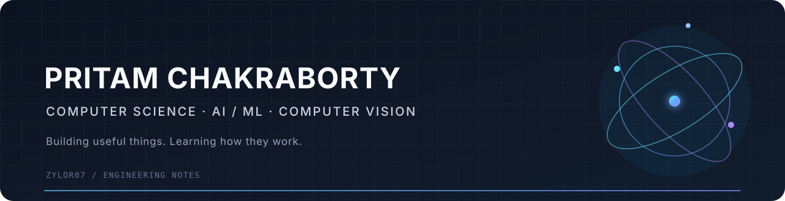

  

### Computer Science Undergrad · AI / ML · Computer Vision · Backend

`404: Motivation not found. 🥷`

---

## `whoami` 👋

I'm **Pritam Chakraborty**, a Computer Science undergraduate (B.Tech, 2027) who enjoys building things at the intersection of **machine learning, computer vision, and software engineering**.

I like understanding how things work under the hood — then turning that understanding into experiments, APIs, and projects. Lately, that has meant working with diffusion-based image restoration, vision pipelines, FastAPI, and model deployment.

- 🔭 **Building:** ML and computer-vision projects, plus backend APIs.
- 🧪 **Exploring:** Generative AI, Agentic AI, diffusion models, and cloud deployment.
- 🧠 **Interested in:** turning research ideas into reliable, usable software.
- 🛠️ **Current mindset:** learn deeply, build steadily, debug honestly.

## Selected work

A few repositories that represent what I like working on:

| Project | What it is | Focus |
|---|---|---|
| [**Blind Image Restoration Using Conditional Diffusion**](https://github.com/Zylor07/blind-image-restoration-final) | A degradation-aware restoration framework using a spatial + FFT encoder, conditional U-Net, and DDPM/DDIM workflow. | `PyTorch` `Diffusion` `Computer Vision` |
| [**Underwater Garbage Detection**](https://github.com/Zylor07/underwater-garbage) | A computer-vision project focused on detecting waste in underwater imagery. | `Computer Vision` `Deep Learning` |
| [**Fast_API_files**](https://github.com/Zylor07/Fast_API_files) | A commented learning workbook covering FastAPI fundamentals, Pydantic, and ML API creation. | `Python` `FastAPI` `Pydantic` |
| [**5G / 6G Data Analysis**](https://github.com/Zylor07/5g-6g_data_analysis) | Notebook-based exploration and analysis of 5G/6G-related data. | `Python` `Jupyter` `Data Analysis` |
| [**OpenCV Practice**](https://github.com/Zylor07/Opencv_practice) | Hands-on experiments with image processing and computer-vision concepts. | `Python` `OpenCV` |

> Have a look through the repositories for source code, implementation notes, and project-specific documentation.

## Toolkit

**Languages**  

**AI / ML & Computer Vision**  

**Backend, Cloud & App Development**  

## GitHub at a glance

  
  

  

Stats and language cards are served by third-party services; their availability and calculations may vary.

## Beyond the commit

- I enjoy taking a project from an idea to a working implementation.
- I keep notes, diagrams, and experiments alongside code whenever they help explain the engineering.
- I believe a useful README is part of the project, not an afterthought.

## Find me

- **GitHub:** [@Zylor07](https://github.com/Zylor07)
- **LinkedIn:** [Pritam Chakraborty](https://www.linkedin.com/in/pritam-chakraborty07/)

---

**Curiosity in production. Common sense in beta.**

Still learning. Still building. Occasionally defeating a bug.

